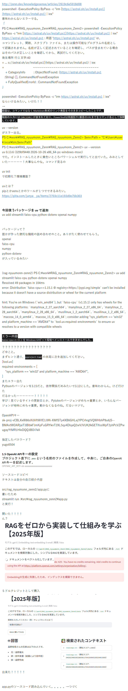

http://zenn.dev/knowledgesense/articles/2619c6e5918d08
powershell -ExecutionPolicy ByPass -c "irm [https://astral.sh/uv/install.ps1](https://astral.sh/uv/install.ps1) | iex"
æ„�味ã‚�ã�‹ã‚“ã�ªã��E‚¨ãƒ©ãƒ¼ã�§ã‚‹ã€�E
�E
PS C:\work\RAG_nyuumonn_Zenn\RAG_nyuumonn_Zenn2> powershell -ExecutionPolicy ByPass -c "irm [https://astral.sh/uv/install.ps1](https://astral.sh/uv/install.ps1) | iex"
https://astral.sh/uv/install.ps1 : 用�E'https://astral.sh/uv/install.ps1' ��E
コãƒ�ンドレãƒ�Eƒˆã€�E–¢æ•°ã€�スクリプト ファイルã€�ã�¾ã�Ÿã�Eæ“�作å�¯èƒ½ã�ªãƒ—ログラムã�®å��å‰�ã�¨ã��E
ã�¦èª�è­˜ã�•ã‚Œã�¾ã�›ã‚“。å��å‰�ã�Œæ­£ã�—ã��記述ã�•ã‚Œã�¦ã��E‚‹ã�“ã�¨ã‚’確èª�ã�—ã€�パスã�Œå�«ã�¾ã‚Œã�¦ã��E‚‹å ´å��E
ã�¯ã��ã�Eパスã�Œæ­£ã�—ã�„ã�“ã�¨ã‚’確èª�ã�—ã�¦ã�‹ã‚‰ã€�å�E試行ã�—ã�¦ã��ã� ã�•ã�„ã€�E
発生場所 è¡�E1 æ–�E­�E40
+ ... s://astral.sh/uv/install.ps1](https://astral.sh/uv/install.ps1) | iex
+                                   ~~~~~~~~~~~~~~~~~~~~~~~~~~~~~~~~
    + CategoryInfo          : ObjectNotFound: (https://astral.sh/uv/install.ps1 
   :String) [], CommandNotFoundException
    + FullyQualifiedErrorId : CommandNotFoundException
�E

powershell -ExecutionPolicy ByPass -c "irm https://astral.sh/uv/install.ps1 | iex"
ã�ªã‚‰ã�„ã�‘ã‚‹ã�¿ã�Ÿã�„。ã�„ã�‘ã�Ÿ�E�E¼�E
�E
å�Ÿå› ã�¯ã€�コãƒ�ンドã�§ã�¯ã�ªã��EMarkdownå½¢å¼�ã�Eリンク表記をã��ã�Eã�¾ã�¾ã‚³ãƒ”ã�Eã�—ã�Ÿã�“ã�¨ã�§ã�™ã€�E
ç�¾åœ¨ã�®å…¥åŠ›ã�«ã�¯ [URL](URL) ã�Œå�«ã�¾ã‚Œã�¦ã�Šã‚Šã€�PowerShellã�¯è§’括弧ã‚�E番目ã�®URLã�¾ã�§ã‚’コãƒ�ンドå��ã�¨ã�—ã�¦è§£é‡ˆã�—ã�¦ã��E�¾ã�™ã€�E
uv --version
�エラー出る�E
PS C:\work\RAG_nyuumonn_Zenn\RAG_nyuumonn_Zenn2> $env:Path = "C:\Users\user\.local\bin;$env:Path"
PS C:\work\RAG_nyuumonn_Zenn\RAG_nyuumonn_Zenn2> uv --version                    
uv 0.13.6 (329bf9448 2026-10-26 x86_64-pc-windows-msvc)
ã�§ã�Ÿã€‚インストã�Eルã�—ã�Ÿã�¨ã��ã�«é»�E‰²ã��E�¨ã�“ã‚�パワーシェルã�§å®Ÿè¡Œã�—ã�¦ã�¨å‡ºã�¦ã��E�Ÿã€‚ã�¿ã�Šã�¨ã�—ã�¦ã��E�Ÿãƒ¼ãƒ¼ãƒ¼ãƒ¼ãƒ¼�E�大事ã�ªã‚“ã‚„ã�ªã€‚コãƒ�ンド見るã�®

uv init
ã�§åˆ�期化？環å¢�E§‹ç¯‰ï¼�E

uv���E�E
pipã�¨ã�‹venvã�¨ã�‹ã�Eãƒ�E�Eルã�Œï¼‘ã�¤ã�§ã�§ã��ã‚‹ã�¿ã�Ÿã�„ã€�E
https://qiita.com/junya__ya/items/2703c11e193d0e7bb303

今å›�使ã��Eƒ‘ãƒ�E‚±ãƒ¼ã‚¸ã‚�Euv ã�§è¿½åŠ 
uv add streamlit faiss-cpu python-dotenv openai numpy

パッケージ���E�E
誰ã�‹ã�Œä½œã�£ã�Ÿä¾¿åˆ©ã�ªæ©Ÿè�Eã�®è©°ã‚�å�ˆã‚�ã�›ã�®ã�“ã�¨ã€‚ã�‚ã‚Šã�Œã�Ÿã��使ã‚�ã�›ã�¦ã‚‚らã��E€�E
openai
faiss-cpu
numpy
python-dotenv
ã�Œå�Eã�£ã�¦ã��E‚‹ã�¿ã�Ÿã�„

(rag-nyuumonn-zenn2) PS C:\work\RAG_nyuumonn_Zenn\RAG_nyuumonn_Zenn2> uv add streamlit faiss-cpu python-dotenv openai numpy
Resolved 49 packages in 104ms
error: Distribution `faiss-cpu==1.15.1 @ registry+https://pypi.org/simple` can't be installed because it doesn't have a source distribution or wheel for the current platform

hint: You're on Windows (`win_amd64`), but `faiss-cpu` (v1.15.1) only has wheels for the following platforms: `manylinux_2_27_aarch64`, `manylinux_2_27_x86_64`, `manylinux_2_28_aarch64`, `manylinux_2_28_x86_64`, `musllinux_1_2_aarch64`, `musllinux_1_2_x86_64`, `macosx_14_0_arm64`, `macosx_15_0_x86_64`; consider adding "sys_platform == 'win32' and platform_machine == 'AMD64'" to `tool.uv.required-environments` to ensure uv resolves to a version with compatible wheels

エラーå†�E®¹
faiss-cpu==1.15.1 ã‚�EWindows 64ビット環å¢�E�¸ã‚¤ãƒ³ã‚¹ãƒˆã�Eルã�§ã��ã�¾ã�›ã‚“ã�§ã�—ã�Ÿã€�E
�EŸï¼Ÿï¼Ÿï¼Ÿï¼Ÿï¼Ÿï¼Ÿï¼Ÿï¼Ÿï¼Ÿï¼Ÿï¼Ÿï¼Ÿï¼Ÿï¼Ÿï¼Ÿï¼�E
ã�©ã‚�E�“ã�¨ã€�E
��ヒント通り�pyproject.toml �末尾�次を追加�������E
[tool.uv]
required-environments = [
    "sys_platform == 'win32' and platform_machine == 'AMD64'",
]
��エラー出�E
Pythonã�®ãƒ�ã�Eジョンã‚�E.15ã� ã�¨ã€�ä¾�存関係ã� ã‚�ã�¿ã�Ÿã�„ã�§3.12ã�«ã�—ã�Ÿã€‚æ„�味ã‚�ã�‹ã‚‰ã‚“。ã�‘ã�©è¡Œã�‘ã��E
ã� ã‚‹ã�‹ã�£ã�Ÿã�Eーーーーー�E�E¼�E¼�E¼�E¼�E
å­¦ã�³�Ešè¦‹ã�¦ã��E‚‹ã‚µã‚¤ãƒˆã�Eæ›´æ–°æ—¥ã�¨ã�‹ã€�Pytohnã�®ãƒ�ã�Eジョンã�Œã‚�ã�¡ã‚�E‡�è¦�ã�¨ã�‹ã€�ã�„ã‚�ã‚“ã�ªãƒ�ã�Eジョンã�Œåœ°å‘³ã�«ã‚�ã�¡ã‚�E‡�è¦�。動ã�‹ã�ªã��ã�ªã‚‹ã�Eã�­ã€‚ã� ã‚‹ã�„ãƒ�ジã�§ã€�E

OpenAPIキー
<YOUR_OPENAI_API_KEY>

æŒ�E®šã�—ã�Ÿãƒ‘スワードï¼�E
yugo0504

1.5 OpenAI APIキー�設�E
プロジェクト直下ã�« .env ã�¨ã��E�†å��å‰�ã�®ãƒ•ã‚¡ã‚¤ãƒ«ã‚’作æ�Eã�—ã�¦ã€�中身ã�«ã€�ã�”自身ã�®OpenAI APIキーを記述ã�—ã�¾ã�™ã€�E
OPENAI_API_KEY=sk-xxxxxxxxxxxxxxxxxxxxxxxx

ソースコードコピã�E
ãƒ�E‚­ã‚¹ãƒˆã�E自åˆ�E�E自己紹介å�E容

src/rag_nyuumonn_zenn2/app.py�
書ã��E�Ÿã�Ÿã‚�
streamlit run .\src\rag_nyuumonn_zenn2\app.py
�実行�E

é–‹ã�„ã�Ÿï¼�E¼�E¼�E¼�E
ん�E

�E•ãƒ‰ãƒ«ã‚¯ãƒ¬ã‚¸ãƒ�Eƒˆã�¨ã�—ã�¦è³¼å…¥

出æ�¥ã�Ÿï¼�E¼�E¼�E¼�E¼�E

app.pyã�®ã‚½ãƒ¼ã‚¹ã‚³ãƒ¼ãƒ‰èª­ã�¿è¾¼ã‚“ã�§ã��E��。。。。。â�Eã�¤ã�¥ã��E
