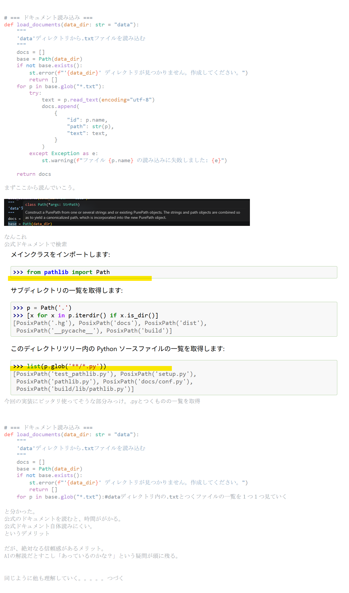

# === ドキュメント読み込み ===
def load_documents(data_dir: str = "data"):
    """
    'data'ディレクトリから.txtファイルを読み込む
    """
    docs = []
    base = Path(data_dir)
    if not base.exists():
        st.error(f"'{data_dir}' ディレクトリが見つかりません。作成してください。")
        return []
    for p in base.glob("*.txt"):
        try:
            text = p.read_text(encoding="utf-8")
            docs.append(
                {
                    "id": p.name,
                    "path": str(p),
                    "text": text,
                }
            )
        except Exception as e:
            st.warning(f"ファイル {p.name} の読み込みに失敗しました: {e}")
            
    return docs

まずここから読んでいこう。

なんこれ
公式ドキュメントで検索

今回の実装にピッタリ使ってそうな部分みっけ。.pyとつくものの一覧を取得

# === ドキュメント読み込み ===
def load_documents(data_dir: str = "data"):
    """
    'data'ディレクトリから.txtファイルを読み込む
    """
    docs = []
    base = Path(data_dir)
    if not base.exists():
        st.error(f"'{data_dir}' ディレクトリが見つかりません。作成してください。")
        return []
    for p in base.glob("*.txt"):#dataディレクトリ内の.txtとつくファイルの一覧を１つ１つ見ていく

と分かった。
公式のドキュメントを読むと、時間ががかる。
公式ドキュメント自体読みにくい。
というデメリット

だが、絶対なる信頼感があるメリット。
AIの解説だとすこし「あっているのかな？」という疑問が頭に残る。

同じように他も理解していく。。。。。つづく

